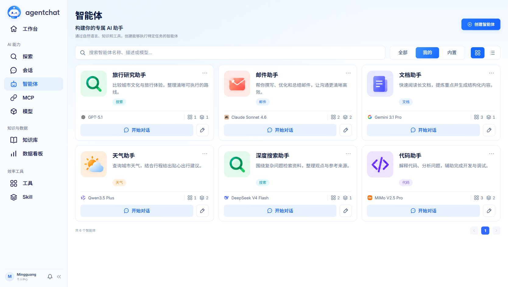
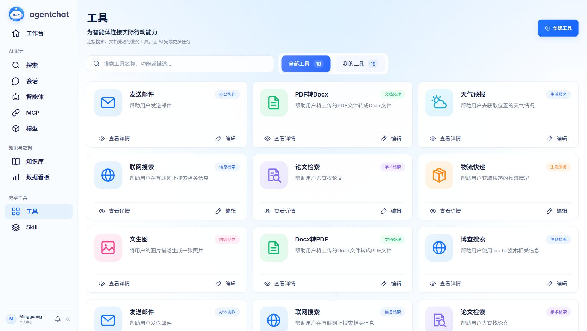
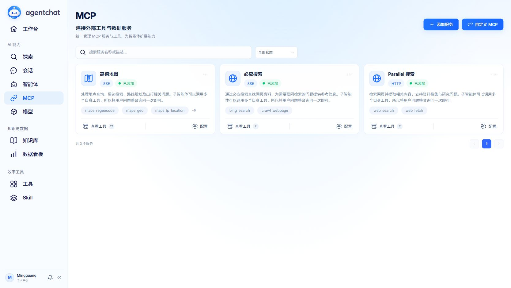

<div align='center'>
    
</div>

<div align="center">

<p align="center">
  
  
  
  
</p>

<p align="center">
  <b>An agent platform connecting models, knowledge, and tools</b>
</p>

<p align="center">
  <a href="#quick-start">Quick Start</a> •
  <a href="#research-agent">Research Agent</a> •
  <a href="#local-docker-sandbox">Docker Sandbox</a> •
  <a href="#advanced-configuration">Deployment Guide</a> •
  <a href="https://shy2593666979.github.io/agentchat-docs/">Documentation</a> •
  <a href="https://agentchat.cloud">Live Demo</a> •
  <a href="https://github.com/Shy2593666979/agentchat-docs/blob/main/images/README.md">Join WeChat Group</a>
</p>

</div>

---

[简体中文](README.md) · [Changelog](docs/CHANGELOG.md)

## Overview

agentchat is an agent application platform with a separate frontend and backend. Connect model services, bind tools, Skills, MCP servers, and knowledge bases to agents, and use those capabilities in conversations. You can also start search, research, and report tasks through Mars and inspect their execution and results. The paper research assistant uses a dedicated state graph for retrieval, reading, evidence verification, and report generation; the local Docker sandbox handles document creation, editing, conversion, and paper PDF parsing.

The local setup uses SQLite, an in-process cache, local file storage, and Chroma. Separate MySQL, Redis, MinIO, and Milvus services are optional.

## Capabilities


| Capability | What it does |
| --- | --- |
| Flexible conversations | Switch agents within a conversation; asynchronously generate a topic title of 2–10 Chinese characters from the first message |
| Agents | Select a model, edit instructions, and bind tools, MCP servers, Skills, and knowledge bases |
| Reliable task execution | Chat uses `/runs` to persist task state, execution events, tool call ledgers, and graph checkpoints, with pause, resume, and result reuse |
| Paper research | Select `paper-research` to break down a topic, search arXiv / Crossref, read public PDFs, compare and verify sources, and export Markdown / JSON |
| On-demand search sub-agents | Run up to 2 read-only search sub-agents in parallel when the work meets independence criteria; the main agent handles reading and verification |
| Local Docker sandbox | Process documents and PDFs through fixed operations in containers without network access; return conversation artifacts with SHA256 hashes and authenticated downloads |
| Context management | Store original materials, versioned working memory, and retrieved excerpts; assemble model input within capacity limits and support rereading original evidence |
| Mars tasks | Start a task from Explore and inspect tool execution and the resulting Markdown report |
| Tools and MCP | Use built-in tools, import OpenAPI specs, or connect SSE / Streamable HTTP MCP servers; create MCP servers through conversation with human confirmation |
| Skills | Load six templates at startup for research reports, data analysis, product documents, code review, email writing, and knowledge organization |
| Knowledge bases | Upload and index documents for retrieval and reranking, with optional full-text search |
| Resource isolation | New users receive separate copies of default agents, tools, Skills, and MCP servers; edits do not affect other users |
| Usage and logs | Track provider-reported token usage and inspect request, run, and tool logs |
| Streaming | Adapt conversation and task events through the shared AG-UI layer |

Model services and external tools have their own configuration requirements. Start with one chat model for basic conversations; knowledge bases need a working embedding model, and some tools require separate API keys.

Chat defaults to the general assistant while retaining the option to switch to specialized assistants. Tool failure retries, task pauses, and checkpoint recovery are supported; see [task execution and recovery](docs/agent-runtime.md).

Select the [paper research assistant](docs/paper-research.md) to break down a topic, retrieve papers, read PDFs, build structured comparisons, and verify citations. You can also revise the research direction and export a report with sources.

The paper research assistant is available in chat; Mars on the Explore page is a separate task entry point. Basic chat does not require Docker. Document creation, conversion, paper PDF parsing, and saving research reports require a prepared sandbox image. If Docker is unavailable, these operations do not fall back to host execution.

See the [changelog](docs/CHANGELOG.md) for earlier interface, conversation, resource isolation, AG-UI, token usage, and logging updates. For the added capabilities, see [task execution](docs/agent-runtime.md), [paper research](docs/paper-research.md), [context management](docs/context-management.md), and the [local sandbox](docs/local-sandbox.md).

## Contents

- [Screenshots and demos](#screenshots-and-demos)
- [Project structure and entry points](#project-structure-and-entry-points)
- [Quick start](#quick-start)
- [First use](#first-use)
- [Research Agent](#research-agent)
- [Local Docker sandbox](#local-docker-sandbox)
- [Minimal examples](#minimal-examples)
- [Advanced configuration](#advanced-configuration)
- [Development and checks](#development-and-checks)
- [Known limitations and outstanding items](#known-limitations-and-outstanding-items)
- [Documentation](#documentation)
- [License and support](#license-and-support)

## Screenshots and demos

### Explore task demo

Enter a goal on the Explore page to follow task execution and read the full report:

> Compare the influence of China's four great ancient capitals and create a travel guide for these four cities.

https://github.com/user-attachments/assets/640650f3-4134-452a-9d17-6f850dabe95f

Start a task from Explore and follow deep search, source organization, and report generation. The video is edited to show only the application.

### Current interface

#### Dashboard

View model calls, token usage, seven-day trends, and recent activity.


#### Model services

One model from each of six providers illustrates display names, provider icons, and API configuration. The `show_model` display name and the model identifier sent in requests are managed separately.


#### Agents and capability management



<table>
<tr>
<td width="50%"><b>Tools</b><br>Manage built-in tools and custom capabilities.<br><a href="docs/media/tools.jpg"></a></td>
<td width="50%"><b>Skills</b><br>Organize reusable working knowledge into Skills.<br><a href="docs/media/skills.jpg"></a></td>
</tr>
<tr>
<td width="50%"><b>MCP</b><br>Connect external tools and data services.<br><a href="docs/media/mcp.jpg"></a></td>
<td width="50%"><b>Knowledge bases</b><br>Organize knowledge spaces by topic.<br><a href="docs/media/knowledge.jpg"></a></td>
</tr>
</table>

<details>
<summary>View the sign-in page</summary>


</details>

## Project structure and entry points

The following paths are the main starting points for running and studying the added capabilities:

```text
agentchat/
├── src/
│   ├── backend/
│   │   ├── agentchat/
│   │   │   ├── main.py                 # FastAPI app, initialization, and task service lifecycle
│   │   │   ├── settings.py             # YAML configuration selection and simple-mode defaults
│   │   │   ├── config.simple.yaml      # Lightweight local configuration template
│   │   │   ├── api/v1/runs.py          # Create, subscribe to, pause, resume, and export tasks
│   │   │   ├── core/agents/            # General assistant, paper research graph, search sub-agents
│   │   │   ├── services/               # Task scheduling, context, source reading, and sandbox/
│   │   │   ├── database/               # Business models, DAOs, initialization, and default resources
│   │   │   └── tools/                  # Search, document conversion, and other tools
│   │   ├── tests/                      # Regression tests and optional real Docker tests
│   │   ├── pyproject.toml              # Python runtime and development dependencies
│   │   └── uv.lock                     # Locked Python dependencies
│   └── frontend/
│       ├── src/pages/conversation/     # Chat and task status interface
│       ├── src/apis/runs.ts            # Task APIs, SSE subscriptions, and artifact downloads
│       ├── vite.config.ts             # Development server and /api proxy
│       └── package.json               # Frontend dependencies and dev, check, and build commands
├── docker/
│   ├── sandbox/                       # Separate document sandbox Dockerfile and fixed worker
│   └── docker-compose.yml             # Existing full application container deployment
├── scripts/build-sandbox.ps1           # Windows sandbox image build script
├── docs/                              # Configuration, execution, research, context, and sandbox guides
└── .github/workflows/ci.yml            # Backend tests and frontend checks and builds
```

| Entry point | Responsibility |
| --- | --- |
| `agentchat.main:app` | Backend application entry point; the example listens on `127.0.0.1:7860` |
| `npm run dev` in `src/frontend` | Start the Vue 3 / Vite frontend on the example port `8090` |
| [`core/agents/general_agent.py`](src/backend/agentchat/core/agents/general_agent.py) | General assistant with built-in tools and sandbox tool integration |
| [`core/agents/paper_research_agent.py`](src/backend/agentchat/core/agents/paper_research_agent.py) | Paper research state graph; [`research_subagent.py`](src/backend/agentchat/core/agents/research_subagent.py) handles search delegation and subgraph execution |
| [`services/agent_runs.py`](src/backend/agentchat/services/agent_runs.py) / [`run_tools.py`](src/backend/agentchat/services/run_tools.py) | Background task lifecycle, checkpoints, tool execution, and retries |
| [`services/research_sources.py`](src/backend/agentchat/services/research_sources.py) / [`context.py`](src/backend/agentchat/services/context.py) | Controlled source retrieval, evidence storage, working memory, and model input capacity management |
| [`services/sandbox/runtime.py`](src/backend/agentchat/services/sandbox/runtime.py) / [`docker/sandbox/worker.py`](docker/sandbox/worker.py) | Boundary between the host controller and fixed operations inside the container |

`scripts/start.py` can also start the frontend and backend, but its dependency installer only looks for `request*.txt` at the repository root and does not use the backend `uv.lock`. For reproducibility, use the step-by-step installation with locked dependencies below.

## Quick start

### 1. Prerequisites

- Git, Python 3.12, and Node.js 22, matching the CI environment.
- [uv](https://docs.astral.sh/uv/getting-started/installation/) for Python environments and locked dependencies.
- A working model API key, endpoint, and model identifier. The example below uses the Tongyi-compatible endpoint and `qwen-plus` from the repository's simple configuration template; service availability was not verified during this update. The general assistant needs tool calling support, and the paper research implementation requires JSON mode structured output.
- For document tools or the complete paper research workflow, Docker CLI, a running Linux Docker engine, and a prebuilt sandbox image. On Windows, use Docker Desktop with the WSL2 / Linux containers backend; see [Local Docker sandbox](#local-docker-sandbox).

Confirm that `uv --version` and `node --version` work in your terminal. Python dependencies are managed through `pyproject.toml` / `uv.lock`, and frontend dependencies through `package.json` / `package-lock.json`. Core components include FastAPI, LangChain / LangGraph, SQLModel, Vue 3, and Vite.

### 2. Get the source and install backend dependencies

```bash
git clone https://github.com/wuxingyu1231z/agentchat.git
cd agentchat
git checkout 924d66d881955fc874c789ca646d03219da8251a
cd src/backend
uv sync --locked --python 3.12
```

These commands pin the feature commit reviewed for this guide to make reproduction easier. Omit `git checkout` to follow development on the main branch.

### 3. Create a local configuration

Windows PowerShell:

```powershell
Copy-Item agentchat/config.simple.yaml agentchat/config.local.simple.yaml
```

Linux / macOS:

```bash
cp agentchat/config.simple.yaml agentchat/config.local.simple.yaml
```

Edit the following section in `src/backend/agentchat/config.local.simple.yaml`, retaining the rest of the copied template:

```yaml
multi_models:
  chat_model:
    api_key: "your-model-api-key"
    base_url: "https://dashscope.aliyuncs.com/compatible-mode/v1"
    model_name: "qwen-plus"
```

This is the section to edit; retain the other settings in the copied file. When changing providers, update the key, endpoint, and model identifier together. Local files matching `config.local*.yaml` are ignored by Git. In simple mode, tool calling and reasoning inherit the chat model configuration by default. Knowledge base embeddings and reranking have their own API requirements and need to be checked when switching providers; see the [model configuration guide](docs/simple-config.md#模型继承与能力边界).

The paper assistant can search arXiv / Crossref directly without a knowledge base or an embedding model. These sites and source PDFs must be reachable. To add supplementary web search, add the following to the same local configuration file:

```yaml
tools:
  tavily:
    api_key: "your-tavily-search-key"
```

Alternatively, configure `tools.bocha.api_key` and `tools.bocha.endpoint`; see [search configuration](docs/simple-config.md). The paper assistant prefers Tavily, then Bocha. If neither is configured, it continues with academic searches and records that web search is unavailable. Search keys and model keys are configured separately. Restart the backend after changes.

### 4. Run the backend

Keep this terminal in `src/backend` and leave the server running.

Windows PowerShell:

```powershell
$env:AGENTCHAT_CONFIG = "agentchat/config.local.simple.yaml"
uv run --locked uvicorn agentchat.main:app --host 127.0.0.1 --port 7860
```

Linux / macOS:

```bash
export AGENTCHAT_CONFIG=agentchat/config.local.simple.yaml
uv run --locked uvicorn agentchat.main:app --host 127.0.0.1 --port 7860
```

[Health check](http://127.0.0.1:7860/health) should return `{"status":"OK"}`. [Swagger UI](http://127.0.0.1:7860/docs) documents the API. The health check confirms server startup; send a message to verify your model credentials.

### 5. Run the frontend

Open another terminal at the repository root:

```bash
cd src/frontend
npm ci
npm run dev -- --host 127.0.0.1 --port 8090 --strictPort
```

Visit [http://127.0.0.1:8090](http://127.0.0.1:8090). The development server proxies `/api` to the backend on port `7860`.

For a different backend address, set `VITE_API_BASE_URL=http://your-backend:port` in `src/frontend/.env.local` and restart the frontend. Keep backend command-line ports, YAML server settings, and uploaded-file URLs consistent. See the [configuration guide](docs/simple-config.md).

## First use

1. **Register and sign in**: Your account receives its own default tools, Skills, MCP servers, and other resources. Chat defaults to the general assistant, with access to the paper research assistant and custom agents. Create knowledge bases when needed.
2. **Check the model setup**: The YAML `chat_model` configures the system default model. Models added on the model page can be selected by agents. Display names and provider model identifiers are separate fields; use the identifier required by the provider for actual requests.
3. **Start a conversation**: Select an agent and send a message. You can switch agents within the conversation. A topic title is generated in the background and can be renamed manually.
4. **Add capabilities**: Bind tools, Skills, MCP servers, or knowledge bases in the agent editor. A listed MCP server is not automatically bound to the current agent. Confirm external credentials and connectivity before calling it.
5. **Use documents and tasks**: Upload documents and wait for processing before using a knowledge base. Start search and research tasks from Explore. Knowledge retrieval depends on embedding and reranking models; tasks depend on the configuration of the tools they use.
6. **Inspect usage**: View model calls and token usage on the dashboard. Statistics depend on the usage information returned by the provider and may be incomplete when it is missing.

## Research Agent

Select **Paper Research Assistant** (论文调研助手, `paper-research`) in the agent list or beside the chat input, then enter your research topic and constraints. It runs a dedicated LangGraph state graph:

```text
Plan → Delegate/search as needed → Select sources → Read → Compare → Verify evidence → Report
```

| Stage | Current implementation |
| --- | --- |
| Planning and retrieval | Split the topic into 2–4 subquestions with English search queries; search arXiv, Crossref, and the configured web search service |
| On-demand delegation | With at least 3 subquestions and at least 2 substantial tasks that have no prerequisites and sufficiently distinct search scopes, use up to 2 read-only search sub-agents; the main agent merges, deduplicates, and verifies results |
| Selection and reading | Select up to 6 papers and 2 supplementary web pages; recheck paper metadata, try to read public PDFs, and match the title or DOI on the first page |
| Comparison and verification | Extract methods, datasets, experimental findings, limitations, and source page numbers; check quotations and pages first, then make a separate model call to assess whether the text supports each claim |
| Reports and exports | Deterministically build comparison tables and conclusions from verified claims only, with sources, retrieval times, content hashes, and reading limitations; export Markdown reports, research JSON, and execution-event JSONL |

A separate verification call is an independent model request; the current implementation does not require a different provider or model. PDF identity mismatches, full-text retrieval failures, and evidence gaps are recorded. If no evidence passes verification, the report explicitly states that the materials are insufficient.

Chat tasks run in the backend. Refreshing, closing the page, or switching conversations does not cancel them. A pause takes effect at a step boundary after the current model or tool operation returns. Paused, interrupted, or failed tasks can resume, optionally with a revised research direction; each task supports up to 10 direction changes. Saved step results are reused. Changing direction triggers new planning and retrieval, while eligible reading results can be reused.

Recovery requires both the business database and the LangGraph checkpoint file; a JSONL export alone cannot restore a task. Each conversation allows only one unfinished task. Side effects from email, MCP / OpenAPI, and other external operations may still require manual verification. See [task execution and recovery](docs/agent-runtime.md) and the [paper research workflow](docs/paper-research.md).

## Local Docker sandbox

Application deployment containers and the document sandbox are defined separately in `docker/docker-compose.yml` and `docker/sandbox/`. The setup below runs **the backend on the host and document operations in local Docker containers**. The backend handles network retrieval, the database, model calls, and checkpoints. Containers perform fixed document operations; they do not accept arbitrary shell commands or mount the project, database, model keys, or Docker socket.

### 1. Build the image

Start a Linux Docker engine and run the following at the repository root.

Windows PowerShell:

```powershell
docker info --format '{{.OSType}}'
powershell -ExecutionPolicy Bypass -File scripts/build-sandbox.ps1
```

On Linux / macOS, build directly from the same Dockerfile:

```bash
docker info --format '{{.OSType}}'
docker build --tag agentchat-sandbox:v1 docker/sandbox
```

The OS type reported by `docker info` should be `linux`. The build context is limited to `docker/sandbox/`. The default base image is `python:3.12-slim-bookworm`; the image installs LibreOffice Writer, CJK fonts, PyMuPDF 1.26.7, python-docx 1.2.0, and pdf2docx 0.5.8. Building requires network access. Execution uses `--pull never` and does not automatically download missing images. These cross-platform commands follow the Dockerfile and were not tested on Linux / macOS during this update.

The default image name is `agentchat-sandbox:v1`. To use a custom image or digest, set `AGENTCHAT_SANDBOX_IMAGE` in the terminal that starts the backend. Use `AGENTCHAT_SANDBOX_ROOT` to set the sandbox data root. For base image connectivity issues and Windows WSL2 troubleshooting, see the [sandbox guide](docs/local-sandbox.md).

### 2. Use it in a conversation

- The general assistant provides `write`, `edit`, and `read_document`, supporting md / txt / json / csv / yaml / yml / docx / pdf. Names are logical filenames within the current conversation, not host paths. `read_document` returns published artifacts and their hashes, with a length limit on text previews.
- Creating a document fails if the name already exists. Before overwriting or editing, read the latest `sha256` and pass it as `expected_sha256`. `edit` supports text formats only, and the text being replaced must match exactly once. DOCX / PDF files can be regenerated with the original hash.
- DOCX ↔ PDF conversion only accepts **local uploaded attachments whose ownership and content hash are registered and which are included in the current `/runs` request**. Arbitrary storage URLs are not accepted. Older attachments without registration must be uploaded again.
- Paper PDFs are downloaded through controlled backend retrieval, then parsed in the container. Research reports are also written through the sandbox. Artifacts appear in the task status area and can be downloaded with login credentials.

### 3. Resource and isolation boundaries

| Item | Default policy in the code |
| --- | --- |
| Permissions and network | UID/GID `1000:1000`, read-only root filesystem, `--network none`, all capabilities dropped, no privilege escalation |
| Resources | 1 CPU, 1 GB memory, 64 processes, and a 120-second operation timeout per container; up to 2 concurrent sandbox jobs per backend process |
| Inputs and outputs | Only the current inputs are mounted, read-only; `/outputs` is a 32 MB tmpfs and `/tmp` a 256 MB tmpfs; no writable host mounts |
| Publication | The controller validates paths, types, counts, and sizes in the output tar before publishing immutable versions, recording content SHA256 hashes and the actual image ID |
| Storage | Artifacts default to `src/backend/data/sandbox/artifacts/`; `attempts/` retains inputs and outputs for each attempt; download APIs check authentication and ownership |

If Docker is unavailable, the image is missing, or sandbox execution fails, the operation fails without switching to host document processing. Successful jobs can be reused; interrupted jobs rerun fixed steps rather than restoring a process inside the container. The existing Pyodide code agent uses a different execution mechanism and is not an arbitrary code execution entry point for this Docker sandbox.

## Minimal examples

These are manual verification cases. Actual answers and sources depend on the model, network, and accessible materials; this draft does not assume successful results.

### 1. Basic chat

After starting the frontend and backend and registering and signing in, select **General Assistant** (通用助手) and send:

> Explain tool calling in two sentences. Do not call external tools.

Check that you receive an answer and a final task status. A successful `/health` response confirms server startup only; it does not verify model calls.

### 2. Sandbox documents

Build the sandbox image first, then send this in a general assistant conversation:

> Call write to create hello.md with "# Sandbox test" on the first line and "This is the first conversation document." on the next line. Then use read_document to read it and return its sha256.

Check for a `hello.md` download in the task area and verify the file contents. Then send:

> Read the latest sha256 of hello.md, then call edit to replace "This is the first conversation document." with "Editing verified." using that hash. Read the document again to confirm the change.

The file is written only to this conversation's sandbox artifact directory and does not modify the repository README. Check task events and artifacts to confirm that tools actually ran. If the model did not call a tool, its text response alone does not verify the sandbox.

### 3. Paper research

With Docker, a model, and external network access ready, select **Paper Research Assistant** (论文调研助手) and send:

> Research tool failure recovery methods for reinforcement learning agents. Focus on methods, evaluation datasets, and limitations. Use only verifiable sources, explicitly identify missing full text or evidence, and do not rank results across different experimental settings.

Inspect planning, retrieval, reading, and verification records in the research progress view. Once complete, download the Markdown report and research JSON. The JSON lets you review retrieval metadata, reading coverage, candidate claims, and verification results. To test direction changes, pause during execution, wait for the paused state, enter "Focus only on recovery and retries after tool failures; exclude prompt-only optimization," and resume. Check that a new direction version appears. Sub-agents are selected by rules after planning; a simple task with no parallel delegation is also expected behavior.

<details>
<summary>Task endpoints and a minimal request body</summary>

First create a conversation belonging to the current account in the frontend. The JSON below is the body for `POST /api/v1/runs`; replace the conversation and request IDs with actual values. These APIs require login credentials. See [Swagger UI](http://127.0.0.1:7860/docs) for the complete schema.

```json
{
  "conversation_id": "replace-with-your-conversation-id",
  "request_id": "readme-research-001",
  "agent_id": "paper-research",
  "user_input": "Research tool failure recovery methods for reinforcement learning agents, comparing methods, evaluation datasets, and limitations."
}
```

Reuse `request_id` when retrying the same request; use a new value for a new task. The creation response returns the task ID in `data.id`. Replace `{id}` in the endpoints below with that value.

| Method | Path | Purpose |
| --- | --- | --- |
| GET | `/api/v1/runs/{id}` | Query task status and the current answer |
| GET | `/api/v1/runs/{id}/events` | Subscribe to or replay execution events through SSE |
| POST | `/api/v1/runs/{id}/pause` | Request a pause at a step boundary |
| POST | `/api/v1/runs/{id}/resume` | Resume with `{}`, or include `research_direction` to revise the scope |
| GET | `/api/v1/runs/{id}/research/export?format=markdown` | Download the generated report; returns 409 if no report is available yet |
| GET | `/api/v1/runs/{id}/research/export?format=json` | Download research workspace records |
| GET | `/api/v1/runs/{id}/export` | Download execution events as JSONL |
| GET | `/api/v1/runs/{id}/sandbox` | Inspect sandbox job records |

</details>

## Advanced configuration

Simple mode uses the same YAML structure as the full configuration, filling omitted settings with defaults. See [simple configuration](docs/simple-config.md) and the [backend guide](src/backend/README.md) for details.

| Requirement | Setting |
| --- | --- |
| SQLite or MySQL | `database.url`; sync and async drivers are derived automatically |
| Redis | `redis.endpoint`; leave it empty for a local in-process cache |
| Local files, MinIO, or OSS | `storage.mode` and the selected storage configuration |
| Separate models | `multi_models.chat_model`, `tool_call_model`, `reasoning_model`, `embedding`, `rerank`, and other model entries |
| Vector store and full-text search | `rag.vector_db`, `rag.enable_elasticsearch`, and the relevant connection settings |
| Default MCP / Skill templates | `agentchat/config/mcp_server.json`, `agentchat/config/default_skills.json`, and `config/skills/` |
| Logging | `log_level` and the `AGENTCHAT_LOG_DIR` environment variable |
| Web search | `tools.tavily.api_key` or `tools.bocha.api_key` / `endpoint` |
| Checkpoint file | `AGENTCHAT_CHECKPOINT_DB`; defaults to a local `agentchat-checkpoints.sqlite` file |
| Sandbox image / data directory | `AGENTCHAT_SANDBOX_IMAGE` / `AGENTCHAT_SANDBOX_ROOT` |
| Context capacity | `AGENTCHAT_CONTEXT_TOKENS` (default 32000), `AGENTCHAT_CONTEXT_OUTPUT_TOKENS` (default 4096), and `AGENTCHAT_MODEL_CONTEXT_LIMITS`; see [context management](docs/context-management.md) |

Configuration precedence is: explicit loader path → `AGENTCHAT_CONFIG` → `agentchat/config.local.yaml` → `agentchat/config.yaml`. Select `config.local.simple.yaml` explicitly and restart the backend after changes.

When starting from `src/backend`, the business database defaults to `data/agentchat.db` and local uploads to `data/uploads/`. The checkpoint file defaults to a location beside the business SQLite file. Backups need the business database, checkpoints, and any uploads, sandbox artifacts, and vector data still in use. Treat original research materials and execution records as private data and keep them out of public repositories.

The existing [Docker application deployment files](docker/) use MySQL, Redis, MinIO, and the frontend development server, separately from the lightweight local setup above. The current Compose configuration does not provide Docker CLI or an engine connection for the backend, and the backend Dockerfile does not install Docker CLI. Running `docker compose up` alone therefore does not establish access to the new document sandbox. Container deployment also requires checking addresses, credentials, and persistent directories; this setup was not validated during this documentation update.

## Development and checks

In `src/backend`:

```bash
uv sync --locked --group dev
uv run --locked pytest tests -q
```

In `src/frontend`:

```bash
npm ci
npm run lint
npm run build
node --test tests/mars-task.test.cjs
```

Install frontend dependencies to enable the backend's cross-language AG-UI checks. Scripts requiring external services remain under `src/backend/tests/manual` and are excluded from default collection.

[GitHub CI](.github/workflows/ci.yml) runs backend tests and frontend type checks and builds on pushes to `main`, pull requests, or manual dispatch. It uses temporary configuration and databases, without real model keys. Building the frontend generates static files; it does not deploy the application.

For focused regression tests of the added capabilities, run in `src/backend`:

```bash
uv run --locked pytest tests/test_agent_runs.py tests/test_paper_research.py tests/test_research_subagents.py tests/test_context.py tests/test_sandbox.py -q
```

These tests use mocked models, sources, or containers to check behavior and boundaries. They do not establish real network research quality or Docker isolation. After building the image, explicitly enable real container tests:

Windows PowerShell:

```powershell
$env:AGENTCHAT_TEST_DOCKER = "1"
uv run --locked pytest tests/test_sandbox_docker.py -q
```

Linux / macOS:

```bash
AGENTCHAT_TEST_DOCKER=1 uv run --locked pytest tests/test_sandbox_docker.py -q
```

Real Docker tests cover document creation, editing, result reuse, DOCX / PDF conversion and parsing, container cleanup after cancellation, and recovery, with isolation probes. They are skipped unless `AGENTCHAT_TEST_DOCKER=1` is set. Current CI neither builds the sandbox image nor enables this flag, so a normal CI pass does not replace real container verification. These application tests were not run for this README update.

## Known limitations and outstanding items

### Boundaries confirmed in the code

| Area | Current limitation |
| --- | --- |
| Research coverage | Each plan has 2–4 subquestions and selects at most 6 papers and 2 supplementary web pages. This is research assistance within a limited budget, not an exhaustive literature search or systematic review |
| PDF reading | At most 12,000,000 bytes per file, with extraction limited to 300 pages or 2 million characters. No OCR, decryption, or paywall bypass is provided. Extracting text does not mean every passage is analyzed; excerpts are selected for the research direction |
| Evidence quality | Quotation, page, and model-based semantic verification can still miss or misjudge evidence. They do not replace expert judgment, manual checking, or independent reproduction; scores from different datasets cannot be ranked directly |
| Models and network | Keys, model capabilities, site connectivity, API rate limits, and PDF availability affect results. Without Tavily / Bocha, supplementary web search is unavailable |
| Context | Token counts are estimates and capacity is limited. History retrieval primarily uses keywords and reranking, with limited recall for paraphrases. If active requirements still do not fit, an explicit capacity error is returned |
| Task recovery | The current design suits a single machine and relies on the business database and local checkpoints. Multiple hosts with separate checkpoint files are not supported. Pausing waits for the current operation to return and cannot undo external actions already performed |
| Tool side effects | Email, MCP / OpenAPI, and other external actions may already have taken effect after an error. Verify manually before deciding to skip or retry. Exactly-once execution is not guaranteed for external services. The legacy `/completion` endpoint does not provide `/runs` recovery |
| Document operations | DOCX / PDF generation creates paragraphs line by line rather than providing a complete Markdown layout engine. Conversion accepts only authorized local attachments from the current task. Binary formats do not support direct text editing |
| Sandbox storage | Attempt directories are retained for diagnostics and recovery, with no automatic cleanup policy yet. Deleting a conversation removes database authorization records but leaves physical orphan files; deployments need to manage disk space |

## Documentation

The detailed guides below are currently in Chinese:

- [Task execution, pausing, and recovery](docs/agent-runtime.md)
- [Paper research assistant and on-demand multi-agent work](docs/paper-research.md)
- [Local Docker document sandbox](docs/local-sandbox.md)
- [Context, working memory, and evidence rereading](docs/context-management.md)
- [Backend architecture and troubleshooting](src/backend/README.md)
- [Simple configuration and local data](docs/simple-config.md)
- [Flexible conversations](docs/flexible-conversations.md)
- [Private user resources](docs/private-resources.md)
- [Default Skills](docs/default-skills.md)
- [Default MCP servers](docs/mcp-defaults.md) · [Parallel Search](docs/reference/parallel_search_mcp.md)
- [AG-UI protocol](docs/ag-ui.md)
- [Conversation token usage](docs/conversation-token-usage.md)
- [Logging](docs/logging.md)
- [Tests](src/backend/tests/README.md)
- [Changelog](docs/CHANGELOG.md)

## License and support

This project is licensed under the [MIT License](LICENSE).
